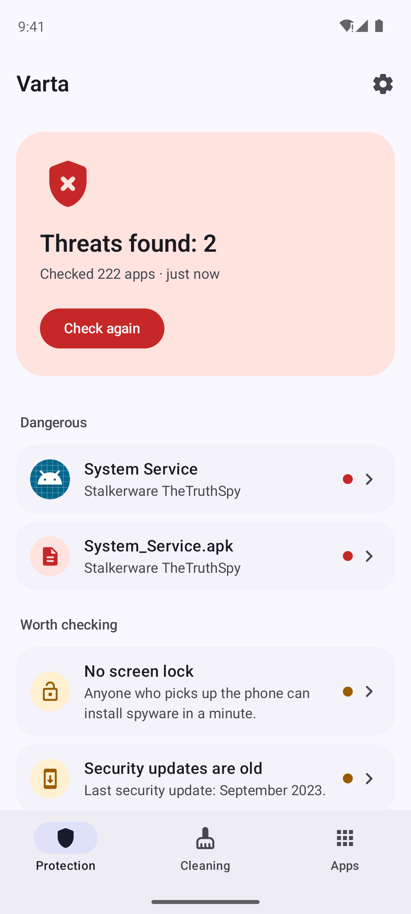
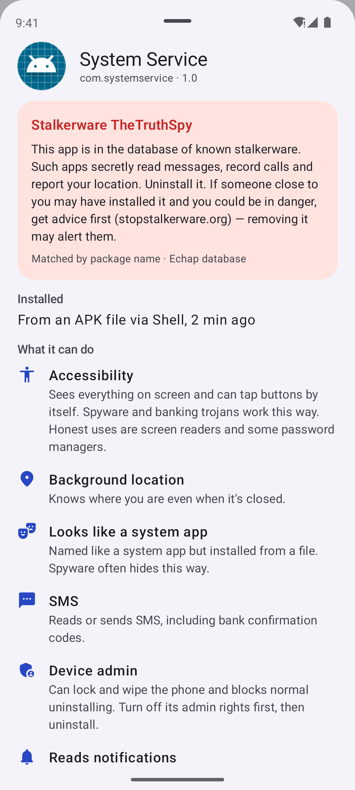
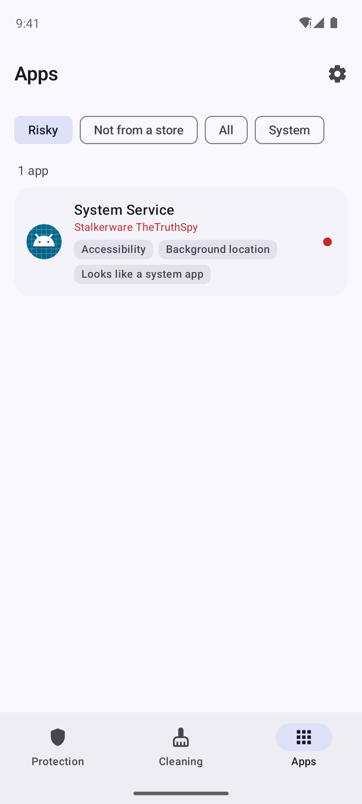
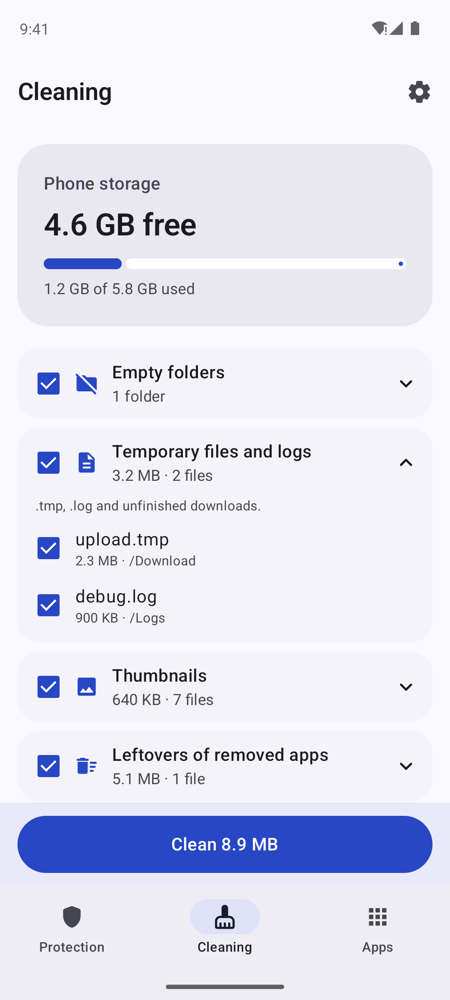

# Varta

<p>
  <a href="https://github.com/hatogg/Varta/releases/latest"></a>
  <a href="https://github.com/hatogg/Varta/actions/workflows/build.yml"></a>
  
  
  <a href="LICENSE"></a>
</p>

<p><a href="README.md">Українська</a> &nbsp;|&nbsp; <b>English</b></p>

**Varta** ("guard" in Ukrainian) checks an Android phone for stalkerware and backdoors, shows apps with suspicious access and risky settings, and cleans up storage junk. It works offline: it sends nothing and shows no ads.

<p>
  <a href="https://github.com/hatogg/Varta/releases/latest"></a>
</p>

<p align="center">
  
  
  
  
</p>

<sub>Real screenshots: GitHub Actions runs Varta in an Android 14 emulator next to a harmless test app that uses a known stalkerware package name, and checks that it is detected.</sub>

## What it checks

| | |
| --- | --- |
| 🕵️ **Stalkerware and backdoors** | Every app is compared with the open [Echap](https://github.com/AssoEchap/stalkerware-indicators) database: 170 known stalkerware apps and RATs (TheTruthSpy, Cerberus, AhMyth, AndroRat and others) and 25 monitoring apps — by package name, signing certificate and file hash. |
| 📦 **APK installers** | APK files in Downloads and messenger folders, before you open them. |
| ⚠️ **Suspicious behaviour** | Accessibility, device admin, notification and SMS access, background microphone and location, apps without an icon, "system" names on apps not from a store. |
| 🔐 **Settings** | Screen lock, age of security updates, USB and wireless debugging, root, user certificates (traffic interception), VPN and proxy. |
| 🔔 **Daily** | Optionally checks new and updated apps once a day and notifies you about threats. |

Every finding is explained in plain words, with buttons next to it: Uninstall, Turn off accessibility, Turn off device admin, App settings, or Trust if you installed it on purpose (parental control, family locator).

## What it cleans

Cache of all apps (via Android 11+ system dialog), empty folders, temporary files and logs, gallery thumbnails, leftovers of removed apps and already installed APKs. Large files (100 MB+) are only listed — you decide. It always asks before deleting.

## Honest limits

Without root no Android app can look inside other apps' files, so Varta doesn't replace an antivirus with a cloud database: a brand-new unknown virus may not be in the database. Its strength is known stalkerware and showing which apps got dangerous access. To be sure, also run Play Protect (there's a button on the home screen).

If you think someone close to you is watching you, removing stalkerware may alert them. Get advice first, e.g. at [stopstalkerware.org](https://stopstalkerware.org/).

## Permissions

`QUERY_ALL_PACKAGES` — see every app so stalkerware can't hide; `MANAGE_EXTERNAL_STORAGE` — APK files and junk; `PACKAGE_USAGE_STATS` — cache sizes; `REQUEST_DELETE_PACKAGES` — the system uninstall dialog; `ACCESS_NETWORK_STATE` — whether a VPN is on; `POST_NOTIFICATIONS` — daily check. There's no internet permission — the CI build fails if one appears.

## Build

```bash
./gradlew :app:testDebugUnitTest :app:assembleRelease
```

Kotlin, Jetpack Compose, Material 3, WorkManager. The database is updated by `tools/update_ioc.py` (Echap data, [CC BY 4.0](NOTICE.md)).

## License

[MIT](LICENSE). Threat database © Echap, CC BY 4.0.
