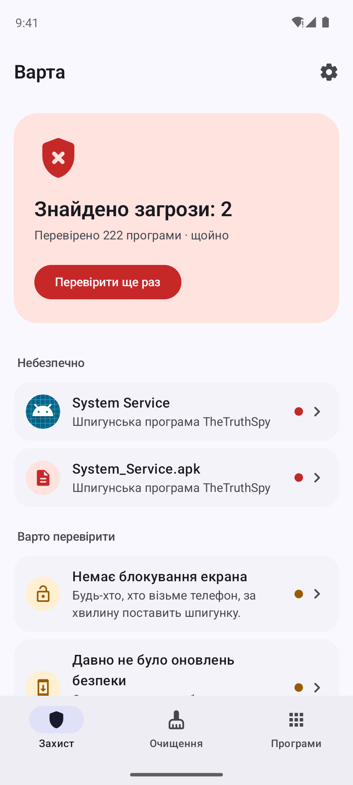
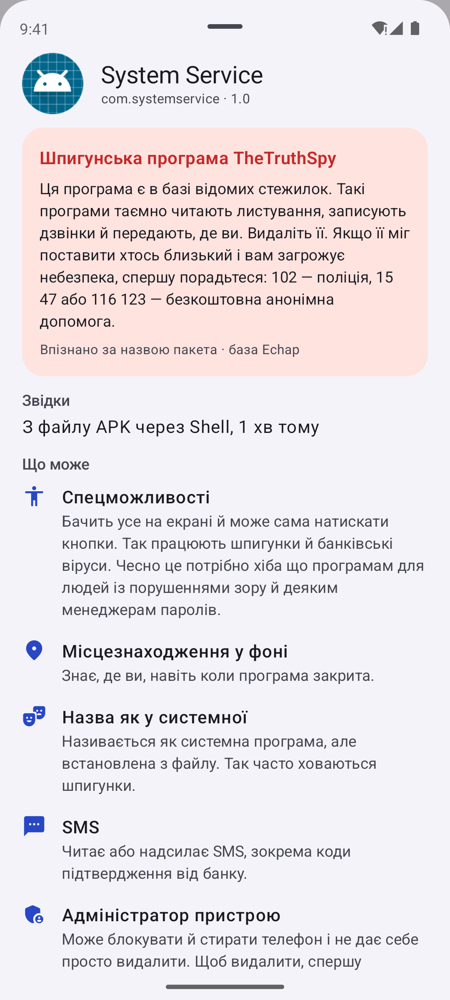
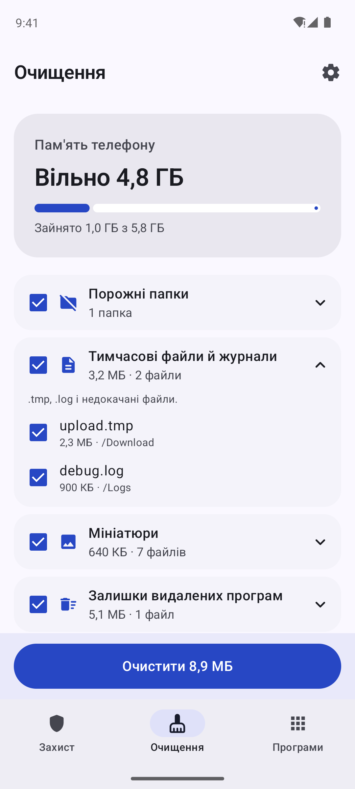
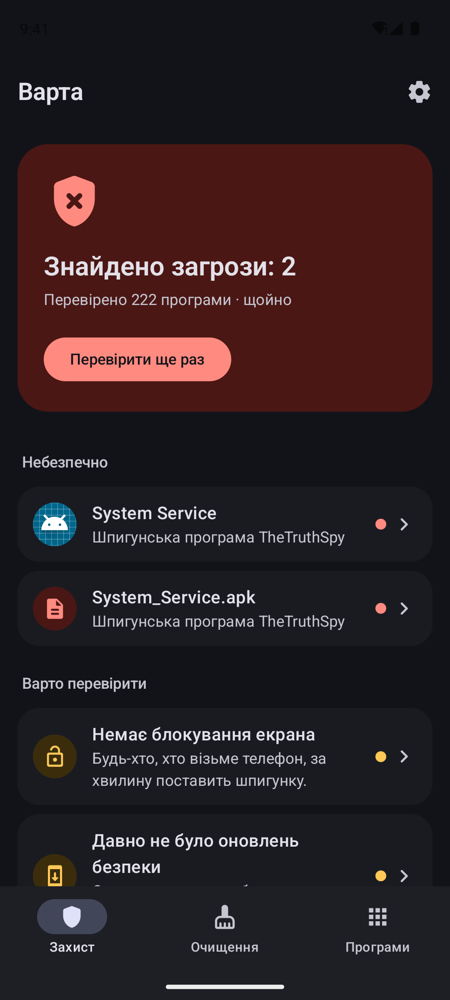

# Варта

<p>
  <a href="https://github.com/hatogg/Varta/releases/latest"></a>
  <a href="https://github.com/hatogg/Varta/actions/workflows/build.yml"></a>
  
  
  <a href="LICENSE"></a>
</p>

<p><b>Українська</b> &nbsp;|&nbsp; <a href="README.en.md">English</a></p>

**Варта** перевіряє Android-телефон на шпигунські програми й бекдори, показує програми з підозрілими правами й небезпечні налаштування, а ще чистить пам'ять від сміття. Працює без інтернету: нічого не надсилає й не показує реклами.

<p>
  <a href="https://github.com/hatogg/Varta/releases/latest"></a>
</p>

<p align="center">
  
  
  
  
</p>

<sub>Справжні скриншоти: GitHub Actions запускає «Варту» в емуляторі Android 14 разом із нешкідливою тестовою програмою, що має назву пакета відомої стежилки, і перевіряє, що її знайдено.</sub>

## Що перевіряє

| | |
| --- | --- |
| 🕵️ **Шпигунки й бекдори** | Кожну програму звіряє з відкритою базою [Echap](https://github.com/AssoEchap/stalkerware-indicators): 170 відомих стежилок і RAT-ів (TheTruthSpy, Cerberus, AhMyth, AndroRat та інші) і 25 програм стеження — за назвою пакета, сертифікатом підпису й хешем файлу. |
| 📦 **Інсталятори APK** | Файли APK у «Завантаженнях» і папках месенджерів — ще до того, як ви їх відкриєте. |
| ⚠️ **Підозрілу поведінку** | Спецможливості, права адміністратора, доступ до сповіщень і SMS, мікрофон і місцезнаходження у фоні, програми без значка, «системні» назви в програм не з магазину. |
| 🔐 **Налаштування** | Блокування екрана, давність оновлень безпеки, налагодження USB і Wi‑Fi, root, чужі сертифікати (перехоплення трафіку), VPN і проксі. |
| 🔔 **Щоденно** | За бажанням раз на день перевіряє нові й оновлені програми і сповіщає, якщо знайде загрозу. |

Кожна знахідка пояснена простими словами, поруч — кнопки: «Видалити», «Вимкнути спецможливості», «Вимкнути адміністратора», «Налаштування програми» або «Довіряю», якщо програму ви ставили свідомо (батьківський контроль, сімейний локатор).

## Що чистить

Кеш усіх програм (системним вікном Android 11+), порожні папки, тимчасові файли й журнали, мініатюри галереї, залишки видалених програм і вже встановлені APK. Великі файли (від 100 МБ) лише показує — що видаляти, вирішуєте ви. Перед видаленням завжди питає.

## Чесно про межі

Без root жодна програма на Android не може зазирнути у файли інших програм, тож «Варта» не замінює антивірус із хмарною базою: зовсім нового невідомого вірусу в базі може не бути. Її сила — у відомих стежилках і в тому, що вона показує, хто з програм отримав небезпечні права. Для певності перевірте телефон ще й Play Захистом (кнопка є на головному екрані).

Якщо вам здається, що за вами стежить близька людина, видалення стежилки може її насторожити. Спершу порадьтеся: **102** — поліція, **15 47** або **116 123** — безкоштовна анонімна допомога.

## Встановлення

1. Завантажте `Varta-1.0.apk` з [релізу](https://github.com/hatogg/Varta/releases/latest) на телефоні.
2. Відкрийте файл і дозвольте встановлення з цього джерела.
3. Для очищення й перевірки APK дайте «Доступ до всіх файлів», а щоб бачити кеш кожної програми — «Доступ до статистики використання». Обидва дозволи необов'язкові.

## Дозволи

`QUERY_ALL_PACKAGES` — бачити всі програми, щоб не пропустити шпигунку; `MANAGE_EXTERNAL_STORAGE` — файли APK і сміття; `PACKAGE_USAGE_STATS` — розмір кешу; `REQUEST_DELETE_PACKAGES` — системне вікно видалення; `ACCESS_NETWORK_STATE` — чи ввімкнено VPN; `POST_NOTIFICATIONS` — щоденна перевірка. Дозволу на інтернет немає — збірка в CI падає, якщо він з'явиться.

## Збірка

```bash
./gradlew :app:testDebugUnitTest :app:assembleRelease
```

Kotlin, Jetpack Compose, Material 3, WorkManager. Базу оновлює `tools/update_ioc.py` (дані Echap, [CC BY 4.0](NOTICE.md)).

## Ліцензія

[MIT](LICENSE). База загроз — © Echap, CC BY 4.0.
